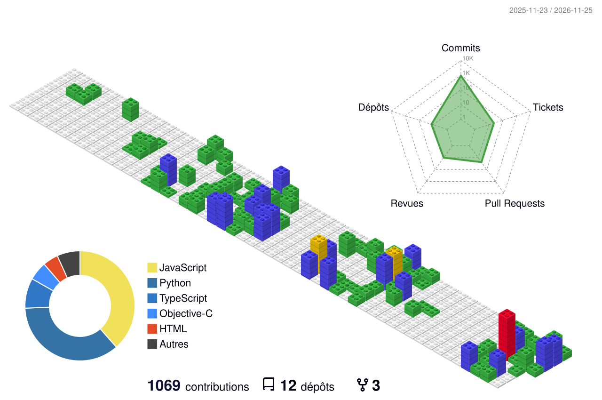

  
  <h2>Justin · Creative Dev, Data & Systems</h2>
  
<em>« Sul Sul ! Bienvenue sur mon terrain résidentiel. »</em>

  
🌟 <strong>Aspiration : Platine</strong> · <em>Zero build crash, maximum optimization</em>

  <picture>
    <source media="(prefers-color-scheme: dark)" srcset="profile-3d-contrib/profile-night-green.svg">
    <source media="(prefers-color-scheme: light)" srcset="profile-3d-contrib/profile-gitblock.svg">
    
  </picture>

---

### ⚡ Core Stack
* **Frontend & 3D** : TypeScript, JavaScript, Three.js, WebGL, UI immersives
* **Data & Local AI** : Python, Pandas, Jupyter, Scraping, Pipelines IA souverains
* **Systems & Reverse** : Shell, macOS Debugging & Patching, Docker, Proxmox & Homelab

### 🎒 Featured Quests
* 🛠️ **[sims2-crash-patch](https://github.com/Justinbdna/sims2-crash-patch)** — Reverse engineering & patch macOS (fix 120Hz ProMotion, notch, Cmd+Tab, Trackpad) pour *Les Sims 2*.
* 🏛️ **[bourbon-ia](https://github.com/Justinbdna/bourbon-ia)** — IA locale souveraine pour l'ordonnancement et l'analyse d'amendements parlementaires.
* 🍿 **[popcorn-disney](https://github.com/Justinbdna/popcorn-disney)** — Expérience web 3D interactive à la première personne.
* ⚡ **[Mix Électrique Régional](https://github.com/Maksen94/Projet-1-Groupe-2)** — Pipeline de données éCO2mix RTE & restitution haute performance.

### 🏆 Lifetime Wants
* 🎯 **Reverse Engineer** : A reverse-engineeré et debuggé *Les Sims 2* sur macOS pour corriger les crashs 120Hz ProMotion et restaurer le support natif du Trackpad/notch.
* 🎯 **RAM Saver** : A compressé un dataset de 464 Mo en 34 Mo Parquet sans faire exploser la RAM.
* 🎯 **Local AI Beast** : A traité 20 000+ amendements en local sans saturer la RAM ni la VRAM.

  Construit entre deux sprints · Dag Dag ! 👋

