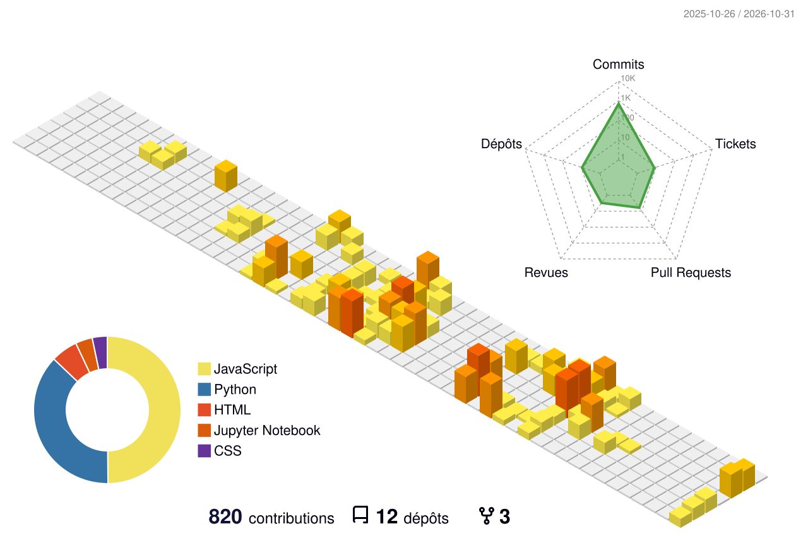

# 💎 Quartier Général de Justin 💎

**Sul Sul ! Bienvenue sur mon terrain résidentiel.**

  <strong>🌟 Jauge d'Aspiration :</strong> Platine <em>(Optimisation maximale, zéro bug au build)</em>

---

### 🏙️ Vue Isométrique des Contributions (La Ville 3D)

  
  
<em>Vue aérienne de mes 800+ constructions de code annuelles.</em>

---

### 📊 Panneau de Compétences

| Domaine | Jauge de Compétence | Spécialités & Stack |
| :--- | :---: | :--- |
| 🧠 **Logique & Data** | `█████████░` | Python, Pandas, SQL, Pipelines automatisés, Architectures Agentiques |
| 🎨 **Créativité & 3D** | `█████████░` | Three.js, WebGL, Low-Poly 3D, Frontend immersif |
| 🛠️ **Systèmes & Hardware** | `████████░░` | Docker, Proxmox, Git, Micro-électronique & Homelab |
| 💼 **Stratégie & Produit** | `█████████░` | Architecture fonctionnelle, Vulgarisation métier, LegalTech |

---

### 🎒 Inventaire des Objets Rares

*Objets d'exception découverts et forgés au fil des quêtes de développement :*

* 🏛️ [**Bourbon.ia**](https://github.com/Justinbdna/bourbon-ia) — Copilote open-source d'analyse législative et des amendements parlementaires.
* 🍿 [**Popcorn Disney**](https://github.com/Justinbdna/popcorn-disney) — Expérience web 3D interactive à la première personne en Three.js.
* 💄 [**Scrapper-Make-up**](https://github.com/Justinbdna/Scapper-Make-up) — Moniteur de veille et benchmark concurrentiel de données.
* ⚡ [**Mix Électrique Régional**](https://github.com/Justinbdna/mix-electrique-regional) — Pipeline de données éCO2mix RTE & restitution haute performance.

---

### 🏆 Souhaits Exaucés du Sim *(Lifetime Wants)*

> 🎯 *« A optimisé un dataset massif de 464 Mo en 34 Mo Parquet sans faire exploser la RAM. »*

> 🎯 *« A traité plus de 20 000 amendements en local sans saturer la RAM (et encore moins la VRAM). »*

---

  Construit avec passion, rigueur et un brin de nostalgie Maxis. Dag Dag ! 👋

